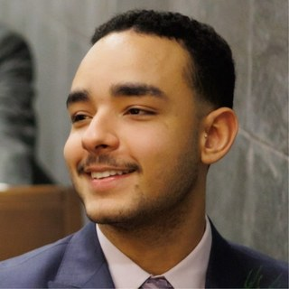

# ZelaBairro · Applied Computer Vision

FIAP · Global Solution 2026.2 · Engenharia de Software

O ZelaBairro é uma proposta de plataforma CitizenTech para o registro e acompanhamento de problemas em espaços públicos, como sinalizações, lixeiras, bancos e calçadas. Este repositório apresenta seu módulo de visão computacional: uma aplicação web em HTML, CSS e JavaScript que usa OpenCV.js e Tesseract.js para ler o texto de fotos de placas e preencher o cadastro da ocorrência.

> **Sobre a fonte das imagens:** as 12 fotos reais de `exemplos_reais/` foram coletadas no Pinterest. Os direitos pertencem aos autores originais, a fonte original de cada foto não foi identificada e as imagens são usadas apenas para demonstração e teste acadêmicos, com remoção imediata a pedido de quem detém os direitos. As 6 imagens de `exemplos/` são sintéticas, geradas por `tools/gerar_exemplos.py`. O módulo não consulta sistemas de prefeitura nem representa a situação real de nenhum local.

## Objetivo do módulo

O cidadão fotografa uma placa e o sistema trata a imagem, lê o texto, sugere a categoria e preenche o cadastro. O texto é sempre revisável antes do registro. O resultado entra no campo `texto_extraido` da ocorrência, no formato do contrato v0 do grupo.

O módulo lê texto, não diagnostica defeito: quem informa o problema é o cidadão. A integração efetiva com a aplicação central do grupo ainda não foi demonstrada; os campos da ocorrência e o `ocorrencias.json` exportado são o contrato de saída proposto.

## Fluxo de processamento

```
Foto da placa (câmera, arquivo ou exemplo)
            |
            v
   Pré-processamento (OpenCV.js)
   variantes: cinza, Otsu, adaptativa,
   centro normalizado, regiões de texto
            |
            v
   OCR em cada variante (Tesseract.js)
   só palavras com confiança >= 60%
            |
            v
   Escolha automática da melhor leitura
            |
            v
   Revisão pelo cidadão -> registro com protocolo
            |
            v
   Consulta, status e exportação em JSON
```

## Pipeline de imagem

| Etapa | Função OpenCV.js | Aula |
|---|---|---|
| 1 | `resize` (INTER_AREA ao reduzir, INTER_CUBIC ao ampliar), largura 1000 px | 11 |
| 2 | `cvtColor` RGBA2GRAY (também é o OCR sem pré-processamento, baseline) | 2 |
| 3 | `equalizeHist` | 4 |
| 4 | `GaussianBlur` 5x5 | 6 |
| 5 | `medianBlur` 5 (ruído sal e pimenta) | 7 |
| 6 | `threshold` Otsu + `connectedComponentsWithStats` (remove manchas e molduras) | 4, 5 |
| 7 | `adaptiveThreshold` bloco 31 + limpeza | 4, 5 |
| 8 | `adaptiveThreshold` bloco 91 + limpeza (letras grandes) | 4, 5 |
| 9 | ROI central, `equalizeHist`, divisão pelo fundo (`GaussianBlur` grande, `divide`) e Otsu | 3, 4, 6 |
| 10 a 14 | Localização de texto (`morphologyEx` GRADIENT, fechamento, componentes conexos) e recorte da região (ROI) com Otsu e adaptativa | 3, 4, 5, 13 |

A polaridade (texto preto em fundo branco) é decidida por uma ROI no centro da imagem. Componentes pequenos (ruído) e muito grandes (moldura da placa) são removidos antes do OCR.

**Automação:** o OCR roda em até 9 variantes e o sistema escolhe sozinho a de maior score (confiança média das palavras mantidas vezes a raiz do número de palavras). Se nenhuma palavra passar do corte de 60%, o app avisa e pede digitação manual.

## Resultados dos testes

Porcentagem média das palavras do texto real que o sistema leu corretamente.

| Conjunto | Imagens | Leituras completas | OCR direto | Com pipeline |
|---|---|---|---|---|
| Sintéticas | 6 | 4 | 33% | 67% |
| Fotos reais, cena completa | 12 | 1 | 29% | 50% |
| Fotos reais, recorte manual da placa | 6 | 1 | 10% | 31% |

As tabelas completas, imagem por imagem, estão em `docs/resultados_testes.md`, `docs/resultados_testes_exemplos_reais.md` e `docs/resultados_testes_exemplos_reais_recortes.md`. As folhas de contato com as etapas de cada imagem estão em `docs/evidencias/`.

Em fotos reais, a leitura completa é a exceção, e o app pode mostrar texto errado com confiança alta (a foto 1 em cena completa lê só "km/", e a foto 5 lê "VAN" em vez de PARE). Por isso o texto é sempre editável e leituras abaixo de 85% de confiança aparecem como "parciais". Funcionam bem placas grandes e contrastantes (foto 3, e o recorte da foto 1). Placas pequenas na cena, à noite, em contraluz ou com texto miúdo (fotos 4, 5, 9 e 12) saem parciais ou falham. Letras e números soltos, e palavras curtas de baixa confiança, são descartados para reduzir o lixo vindo do fundo, ao custo de perder algumas palavras legítimas (a foto 13 perde "GRANDE"). O recorte manual nem sempre ajuda (a foto 1 melhorou, as fotos 3 e 5 pioraram), e são só 6 imagens.

## Estrutura do repositório

```
zelabairro-cv/
├── index.html
├── css/style.css
├── js/
│   ├── pipeline.js      pré-processamento e localização (OpenCV.js)
│   ├── ocr.js           OCR, filtro por palavra, escolha da variante, categoria
│   ├── store.js         persistência local (contrato v0)
│   └── main.js          interface e orquestração
├── exemplos/                  6 imagens sintéticas
├── exemplos_reais/            12 fotos reais (ver nota de fonte)
├── exemplos_reais_recortes/   6 recortes manuais das fotos reais
├── tools/
│   ├── gerar_exemplos.py      gera as imagens sintéticas
│   └── teste_pipeline.mjs     teste de ponta a ponta do pipeline
├── assets/equipe/             fotos da equipe e a imagem de encerramento do vídeo
├── docs/                      tabelas de resultados e evidências
└── README.md
```

## Como reproduzir

Aplicação (precisa de servidor HTTP por causa dos ES modules; OpenCV.js e Tesseract.js vêm por CDN):

```
npx serve .
```

Teste do pipeline no Node, com o Tesseract e o idioma `por` instalados na máquina:

```
npm install
TESSDATA_PREFIX=<pasta com por.traineddata> npm test [pasta]
```

A pasta pode ter um `casos.json` com o texto real de cada imagem. O teste usa o OCR do Tesseract instalado na máquina, então os números no navegador podem variar um pouco.

## Dados e integração

A ocorrência segue os campos `id`, `categoria`, `local`, `descricao`, `foto`, `status`, `data` e `texto_extraido`. O app permite consultar pelo protocolo, trocar o status (pendente, em triagem, concluído) e exportar `ocorrencias.json`. Um status como concluído representa encerramento interno, não comprova reparo físico ou atendimento oficial.

O módulo de Big Data do grupo espera também o campo `origem_dado`, e as categorias dos dois módulos ainda precisam ser alinhadas antes da integração.

## Limitações

- OCR não prova que a placa está danificada.
- Funciona melhor com a placa grande, centralizada e legível.
- Dados no `localStorage` do navegador, sem persistência compartilhada.
- A foto 12 contém um crédito de fotógrafo na própria imagem, que o OCR lê.
- Privacidade: o processamento é local e nada é enviado a servidor próprio. Fotos de uso real exigem autorização, sem rostos nem placas de veículos.

## Documentação

O relatório com transformações, imagens intermediárias, dados extraídos e testes está no PDF único enviado à disciplina. URL pública: [PREENCHER]. Vídeo: [PREENCHER].

## Integrantes

| Foto | Integrante | RM |
|---|---|---|
|  | Gabriel Leão da Silva | 552642 |
|  | Matheus Farias de Lima | 554254 |
|  | Miguel Mauricio Parrado Patarroyo | 554007 |
|  | Pedro Henrique Nardaci Chaves | 553988 |
|  | Vitor Pinheiro Nascimento | 553693 |

Projeto acadêmico desenvolvido para a Global Solution 2026.2 da FIAP. O ZelaBairro não possui integração oficial com órgãos públicos.
